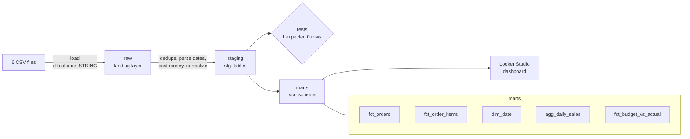

# E-commerce Analytics Pipeline: from messy raw data to a revenue recovery case

I created an end-to-end analytics project in **BigQuery** and **Looker Studio**. It takes six tables, covering **January 2024 to August 2026**, I cleaned nine data defects. Also, I built a star schema with a **budget-vs-actual** mart, I used it to explain a weak year: why **5.74% of orders are cancelled**, to compare the actual budget compliance from 2024 to August 2026 , and finally, to make data-informed decisions to fix the consistent issue, considering the possible root cause of the high cancellation rate.

**[View the Looker Studio dashboard - Press here](https://datastudio.google.com/reporting/89bca2ba-19d2-4587-b4c5-abe2320880ec)**


> **Note:** the dataset is synthetic, and adjusted to published benchmarks (US Census e-commerce data, Circana consumer-tech sales). The pipeline, the data defects-issues and the analysis method are real.

---

## The business story

| | 2024 | 2025 | 2026 (Jan–Aug) |
|---|---:|---:|---:|
| Net revenue | $8.42M | $7.87M (-6.5%) | $5.12M (+4.7% vs Jan–Aug 2025) |
| Revenue orders | 38,907 | 35,750 (-8.1%) | 22,834 (+1.4% vs Jan–Aug 2025) |
| AOV | $216.37 | $220.26 (+1.8%) | $224.24 (+3.2% vs Jan–Aug 2025)|
| Cancellation rate (target) | 5.66% (5.5%) | 5.88% (5.0%) | 5.67% (4.5%) (-6.0% vs Jan–Aug 2025) |

2025 was a weak year: fewer orders, higher discounts and less margin, but partly compensated by a slightly higher AOV. 2026 recovers only partly and is still below 2024. The cancellation rate missed its target every year.

---

## Key finding

Orders that hit a **failed payment cancel at 35.3%**, compared with **2.1%** for orders without one, a 17.0x difference. Failed payments account for **3,921 excess cancellations** (64% of all cancellations, $0.90M in order value).

Two other explanations were tested and rejected:

| Hypothesis | Result | Evidence |
|---|---|---|
| Peak season causes cancellations | Rejected | The four Nov/Dec months ran at 5.65%, below the rest of the year (5.76%) |
| Failed payments cause cancellations | **Confirmed** | 35.3% vs 2.1% baseline |

The second confirmation:
```sql
SELECT
  ROUND(CORR(
    IF(failed_payment_attempts > 0, 1, 0),
    IF(is_cancelled, 1, 0)), 3) AS correlation
FROM marts.fct_orders;
-- output: 0.448
```
the correlation between the variable failed_payment_attempts (x) and is_cancelled (y) is φ = 0.448, a moderate effect by Cohen's (1988) guidelines.

| Correlation (absolute value) | Strength |
|---|---|
| 0.00 – 0.09 | Negligible / none |
| 0.10 – 0.29 | Weak (small) |
| 0.30 – 0.49 | Moderate (medium) |
| 0.50 – 0.69 | Strong (large) |
| 0.70 – 1.00 | Very strong |


The failure rate is about the same for every payment method and order size, which points to a missing retry process rather than a provider problem.

**Recommendation:** 
I recommend implementing a dunning business process:  automatically retrying failed payments with reminders before each retry. This implementation could potentially raise payment recovery rate from 62.6% to 85% (proposed target), which is the equivalent of roughly 36% more recovered orders or $582,264 over the period (from january 2024 to August 2026) at an AOV of $219.64.

```sql
SELECT 
 COUNTIF(failed_payment_attempts > 0) AS failed_Attempts,
 COUNTIF(failed_payment_attempts > 0 AND payment_captured) AS recovered_orders_today,
 -- proposed target
 ROUND(COUNTIF(failed_payment_attempts > 0) * 0.85) 
   - COUNTIF(failed_payment_attempts > 0 AND payment_captured) AS extra_recovered_target,
 ROUND(AVG(IF(is_revenue, order_total, NULL)), 2) AS AOV,
 -- what it equals to revenue, considering the AOV
 ROUND((ROUND(COUNTIF(failed_payment_attempts > 0) * 0.85)
   - COUNTIF(failed_payment_attempts > 0 AND payment_captured))
   * AVG(IF(is_revenue, order_total, NULL))) AS revenue_recovered_target      

FROM `marts.fct_orders`
```
Output from this query (R = Recovered or Recovery):

| failed_orders | R_today | R_rate_today | target | extra_R | aov | Revenue_R 
|---:|---:|---:|---:|---:|---:|---:|
| 11,813 | 7,390 | 62.6% | 85% | 2,651 | $219.64 | $582,264 |


---

## Architecture



| Layer | Purpose |
|---|---|
| raw | Exact copy of the CSVs. Every column loaded as "STRING" so nothing is lost on load |
| staging | One clean table per source: deduplicated, typed, normalized, blanks to "NULL".  |
| marts | Star schema for reporting: facts, a date dimension, a pre-aggregated daily table and budget vs actual |


---

## Results

| Metric | Value |
|---|---:|
| Net revenue (completed + shipped orders, Jan 2024 – Aug 2026) | $21,412,859.34 |
| Item revenue (products only, before shipping, tax and discounts) | $20,480,462.26 |
| Average order value | $219.64 |
| Cancellation rate | 5.74% |
| Orders | 106,787 |
| Largest states | CA 13.01%, TX 9.06%, FL 6.52%, NY 6.39% |

net revenue = item revenue + subtotal adjustments − discounts + shipping + tax


## Tools

BigQuery · SQL · Looker Studio 

## Author

**César Augusto Arrauth López** · Industrial Engineer · 
[LinkedIn](https://www.linkedin.com/in/c%C3%A9sar-arrauth/)
